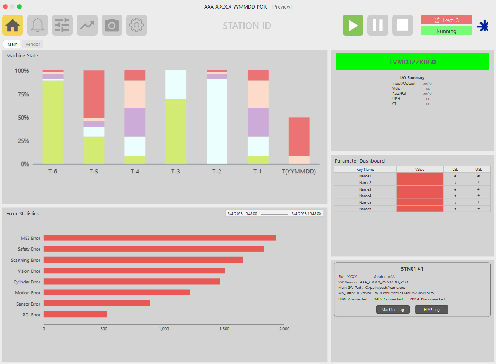

# A_SW_DFM

A WPF control-library demo built on **.NET 10**, showing a station HMI (home page, dashboards and status panel) assembled from reusable controls.

## Screenshots

All screenshots live in [`docs/ScreenShots/`](docs/ScreenShots/).

### Home page — `home-page.png`



The station home page, running on design-time sample data:

| Area | What it shows |
| --- | --- |
| Top bar | Navigation (home, alarms, stations, trend, camera, settings), station ID, run / pause / stop controls, machine level and running state |
| Main / Vendor tabs | Production view and vendor information |
| Machine State | 100% stacked bar chart across six time buckets (`T-6` … `T-1`) plus the current day (`T(YYMMDD)`) |
| I/O Summary | Input/Output, Yield, Pass/Fail, UPH and CT for the current unit |
| Parameter Dashboard | Key parameters with `LSL` / `USL` limits; out-of-limit values are highlighted |
| Error Statistics | Ranked horizontal bars for MES, Safety, Scanning, Vision, Cylinder, Motion, Sensor and PDI errors over a selectable time window |
| Station card | Site, vendor, software version, build hash, HIVE / MES / PDCA connection state, and Machine Log / HIVE Log entry points |

Every value in the screenshot (`xx`, `Name1` … `Name6`, the placeholder `T(YYMMDD)` bucket) is sample data — no production data is included.

## Run the demo

A prebuilt self-contained build is committed under `Release/win-x64/`:

```text
Release/win-x64/Wpf.Controls.Demo.exe
```

## Adding screenshots

Drop the image into `docs/ScreenShots/` and reference it with a relative path, e.g.:

```markdown

```
